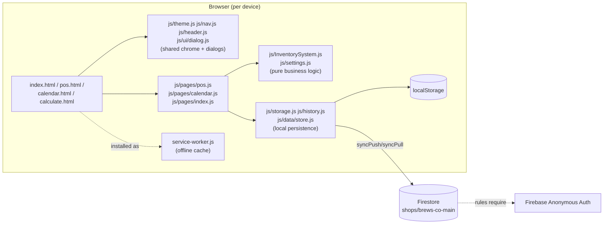

# Architecture

## Overview

A static PWA — no bundler, no framework, no build step. Four HTML pages share a common set of `js/` modules, a `css/styles.css` design system, and sync through one Firestore document. This document explains the structure after the engineering pass in `CHANGELOG.md`, and the reasoning behind the parts that are easy to misread as "just missing," rather than "deliberately deferred."

## Why per-page JS files instead of a bundler

The audit's #1 architecture finding was that `pos.html`, `calendar.html`, and `index.html` each had their entire page logic (up to 1,545 lines) inline in a `<script>` tag. That code has now been extracted 1:1 into `js/pages/pos.js`, `js/pages/calendar.js`, and `js/pages/index.js` — same code, same execution order, loaded via `<script src="...">` instead of inline. This was a **mechanical extraction**, not a rewrite: it fixes the separation-of-concerns and cacheability problems without introducing a build step, a framework, or any behavior change, which matters for an app in daily production use at a real shop. `calculate.html`'s inline blocks were small (44/13 lines) and were left as-is — extracting them wasn't worth the churn.

A "real" module bundler (Vite, esbuild, etc.) was considered and deliberately not introduced: it would add a build step, a `node_modules` folder, and a deploy pipeline dependency to a project that currently deploys by copying static files — a cost not justified until the team size or code size actually needs it.

## The order-log merge fix (the most important reliability change)

**Before:** `brewsOrderLog` stored one entry per calendar date, each holding *that device's entire day of orders*. Syncing merged by date, with local replacing cloud outright on a match. If two devices both took orders on the same day, whichever pushed last **silently deleted** the other device's orders for that day from the cloud copy.

**After:** every order now carries a `uuid` (`pos.html`'s `placeOrder()`). `js/sync.js`'s `_mergeOrderLog()` merges the `orders` array **within** each date entry, keyed by `uuid`, instead of replacing the whole date entry. Two devices' same-day orders are now unioned, not overwritten. Legacy orders saved before this change (no `uuid`) fall back to a synthetic key so they're never dropped by the new logic either.

`inventoryHistory` (the end-of-day calculation) intentionally keeps the old whole-entry-per-date merge — there is only ever one calculation per day per shop, so replacing the whole entry on conflict is correct there; it was `brewsOrderLog`'s different shape (many orders per day) that made the old strategy wrong specifically for it.

## Security model — what's enforced where, honestly

| Layer | Enforces | Status |
|---|---|---|
| App UI (`js/nav.js`, `js/header.js`, page logic) | Hides manager-only controls from workers | Was already true, unchanged |
| `brewsDeviceRole` (`localStorage`) | Which UI a device sees | **Not** a security boundary — flippable by anyone with the app open |
| `firestore.rules` (new) | Requires an authenticated request to read/write the shop document | New — closes the "no rules at all" gap |
| Firebase Anonymous Auth (new, opt-in via console) | Gives every device a stable identity rules can check | New — see `docs/FIREBASE_SETUP.md` |
| Per-employee accounts / server-enforced worker vs. manager permissions | — | **Not implemented.** Would need real identities (email/PIN login + custom claims, or a Cloud Function) — a larger change than this pass's scope, and one that changes the shop's daily workflow (currently "just open the app"), so it's deliberately left for a dedicated follow-up rather than bundled in here silently. |

## Data model — deferred restructuring

The audit recommended eventually normalizing the single `shops/brews-co-main` document into Firestore sub-collections, so history can grow indefinitely without hitting Firestore's 1 MiB per-document limit. That restructuring is a breaking change to the sync code and wasn't performed in this pass, per the "no big-bang rewrite" instruction for a system in daily production use. Instead, two nearer-term mitigations were implemented that buy meaningful headroom without a breaking change:

1. **Cloud-side pruning** (`js/sync.js`'s `_pruneForCloud`) — the cloud document is now trimmed to the retention window on every push, matching what `pos.html`'s local `cleanupOrderLogs()` already did locally. Previously only the local copy was ever pruned.
2. **Per-order merge** (above) — reduces the chance that a full resync ever needs to reconcile large diverged datasets.

The sub-collection restructuring remains the right Phase 3/4 project once the shop's data volume or multi-store ambitions make the 1 MiB ceiling a real near-term risk.

## PWA / offline

- The service worker (`service-worker.js`) now lists every current asset (previously several files — including the newly-extracted `js/pages/*.js` — weren't cached, and `calculate.html`/`index.html` were missing from the cache list entirely).
- It no longer calls `self.skipWaiting()` unconditionally on install. A new version now waits until the page explicitly confirms via `js/ui/sw-register.js` (a themed "Update now?" prompt), so a tab is never silently switched to a new cache while still running old in-memory JS — the previous behavior was a real version-skew bug, not just a missing nicety.
- The service worker is now registered on **every** page (`js/ui/sw-register.js`, included on all four HTML files), not just `index.html` — a device that was ever deep-linked straight into `pos.html` previously never got offline support at all.
- `offline.html` is now the fallback for an uncached navigation with no network, instead of a raw failed fetch.
